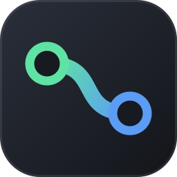

# tuyau

A declarative PipeWire patchbay: a GPU-rendered graph editor ([GPUI-CE](https://github.com/gpui-ce/gpui-ce)) and a CLI, sharing one config file you can keep in Nix.

- **Stateless config.** Links, aliases, volumes and positions live in a read-only TOML file. The GUI never writes to it.
- **Auto-reconnect.** `tuyau watch` (or the GUI with *Auto-connect* on) recreates declared links whenever their nodes appear.
- **Tidy graph.** Nodes are laid out along the signal flow with the Sugiyama method (the one behind Graphviz `dot`): wire crossings are minimized and linked ports are lined up. New nodes appear next to what they are wired to. Drag nodes, hide noise, or press *Arrange* to lay everything out again.
- **Volume and mute** on every card, from the CLI, or set from config when a node appears.
- **Rename** nodes with a double-click on the title.

## Run

```sh
nix run github:<owner>/tuyau            # GUI
nix run github:<owner>/tuyau -- ls      # CLI
```

Or `nix develop`, then `cargo run --release`.

## GUI

| Action | How |
| --- | --- |
| Link two ports | Drag from one port onto another |
| Link a port to a node | Drag a port onto a card; the matching channel is picked |
| Remove a link | Right-click the wire → *Disconnect*, click the dot in the middle of the wire, or drag between the same ports again |
| Move a node | Drag its card |
| Pan | Drag the background, or scroll |
| Zoom | <kbd>Ctrl</kbd> + scroll; *Fit* shows everything, the percentage button resets to 100% |
| Rename | Double-click the title, type, <kbd>Enter</kbd> (empty name resets) |
| Volume | Drag or scroll the slider; **M** toggles mute |
| Undo / redo | <kbd>Ctrl</kbd>+<kbd>Z</kbd> / <kbd>Ctrl</kbd>+<kbd>Shift</kbd>+<kbd>Z</kbd> or <kbd>Ctrl</kbd>+<kbd>Y</kbd>: links, volume, mute, moves, renames, hiding |

The GUI never writes the config. It keeps two files in `$XDG_STATE_HOME/tuyau/`:

- `state.toml`: renames, hidden nodes and links you made by hand. It changes only on those edits, adds to the config (renames win over it), and `tuyau state export` prints it as config rules to copy into your Nix config. Links made by hand are kept like config links while *Auto-connect* is on, and by `tuyau watch`.
- `ui.toml`: node positions, the view and *Auto-arrange*. It changes all the time and is not meant to be versioned.

## CLI

```sh
tuyau ls [--json] [--all]              # nodes, ports, links
tuyau link Spotify Headphones          # pairs channels automatically
tuyau link synth mixer -p FL:FR        # explicit port pairs
tuyau unlink Spotify Headphones
tuyau volume Headphones                # show
tuyau volume Headphones 60%            # also 0.6, +5%, -5%
tuyau mute Headphones [on|off|toggle]
tuyau apply [--dry-run]                # apply the config once
tuyau watch                            # keep applying it (auto-reconnect)
tuyau check                            # validate the config
tuyau state export|clear|path
```

Nodes are selected by id, or by a case-insensitive glob over name, description, nick, application name and alias.

## Config

`$XDG_CONFIG_HOME/tuyau/config.toml`, or `--config` / `$TUYAU_CONFIG`:

```toml
# Rules apply to every node they match.
[[node]]
match = "alsa_output.usb-Focusrite*"   # glob over name, description, nick, application, alias
alias = "Monitors"
volume = 0.8                           # applied when the node appears (1.0 = 100%)
mute = false

[[node]]
match = { application = "spotify", media-class = "Stream/Output/Audio" }  # restrict fields
alias = "Music"

[[node]]
match = "Dummy-Driver"
hidden = true

[[node]]
match = "Monitors"
position = { x = 760, y = 0 }

# Links are kept in place while their nodes exist.
[[link]]
from = "Music"
to = "Monitors"
exclusive = true                       # remove other links leaving Music

[[link]]
from = "Synth"
to = "Monitors"
ports = [["FL", "FR"], ["FR", "FL"]]   # swap channels; matches port name, alias or channel
```

Unknown keys are errors, so typos fail loudly (`tuyau check`).

## Home Manager

```nix
{
  inputs.tuyau.url = "github:<owner>/tuyau";

  # in your home configuration
  imports = [ inputs.tuyau.homeManagerModules.default ];
  programs.tuyau = {
    enable = true;
    service.enable = true;   # runs `tuyau watch` as a user service
    settings = {
      node = [
        { match = "alsa_output.usb-Focusrite*"; alias = "Monitors"; volume = 0.8; }
      ];
      link = [
        { from = "spotify"; to = "Monitors"; }
      ];
    };
  };
}
```

## Limitations

- Volume uses the node's `Props` (software volume). On ALSA devices this is not the hardware route volume that pavucontrol shows.
- Positions, GUI renames and hand-made links are keyed by `node.name`, so nodes sharing a name (e.g. every Brave stream) share them.

## Layout

```
crates/tuyau-core       graph model, config, link planning, auto layout (no PipeWire, unit tested)
crates/tuyau-pipewire   PipeWire thread: graph snapshots out, commands in; the reconciler
crates/tuyau-gui        GPUI-CE graph editor
crates/tuyau            the binary: CLI, and the GUI when run without a subcommand
nix/home-manager.nix    Home Manager module
```
