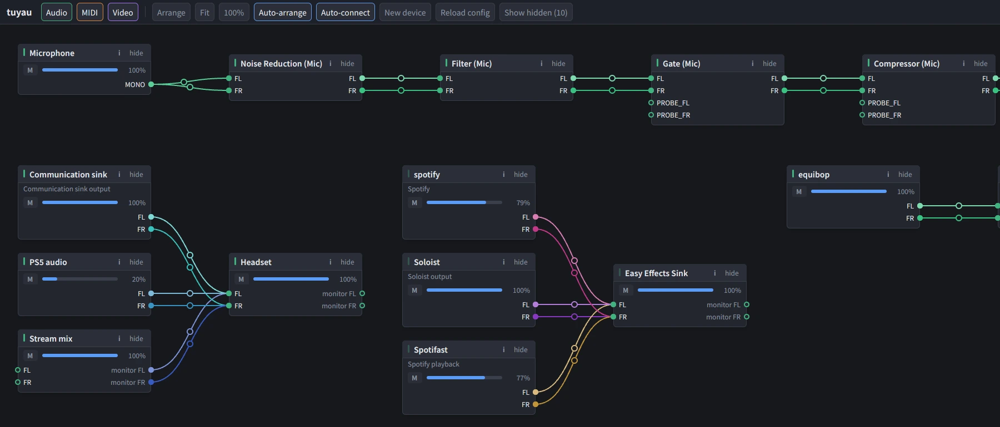
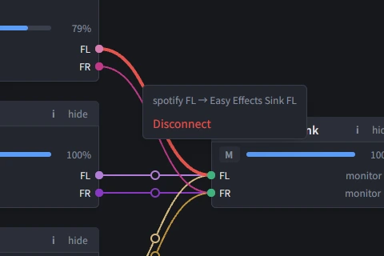
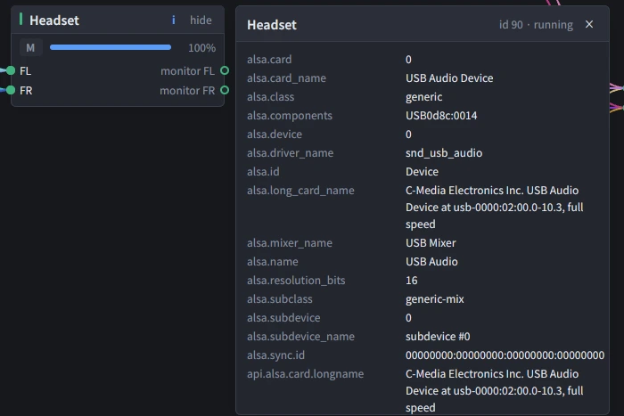
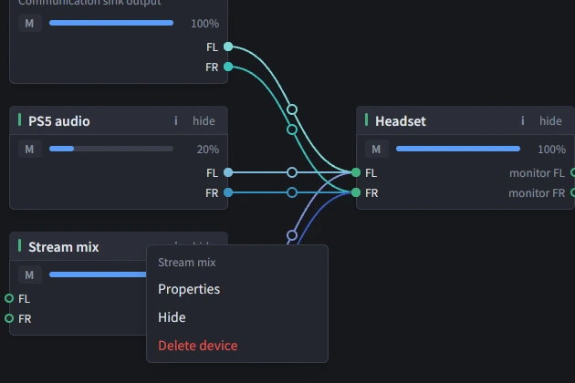
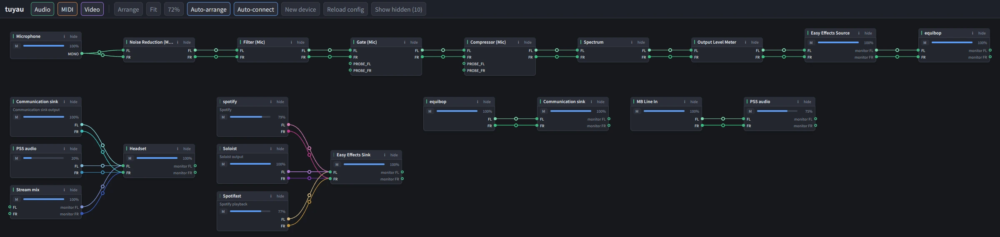

<div align="center">


# tuyau

**The PipeWire patchbay you can keep in a file.**

A GPU-rendered graph editor and a CLI that share one config.
Wire things by hand, and they stay wired.

[Website](https://vincent-hd.github.io/tuyau/) · [Features](#features) · [Install](#install) · [Config](#config) · [tuyau vs Crosspipe](#tuyau-vs-crosspipe)



</div>

## Features

- **Declarative config.** Links, renames, volumes and virtual devices live in a read-only TOML file. The GUI never writes to it, so it fits in Nix as is.
- **Auto-reconnect.** Declared links are recreated whenever their nodes appear, by the GUI or by `tuyau watch` running as a user service.
- **A layout that untangles.** Nodes follow the signal flow, wire crossings are minimized and linked ports line up (the Sugiyama method, as in Graphviz `dot`). *Auto-arrange* keeps it tidy as streams come and go.
- **Volume and mute** on every card, from the CLI, and from the config when a node appears.
- **Virtual devices.** Create sinks and sources to group streams, and route them to `@default-sink@` so they follow your output.
- **Undo everything.** Links, volumes, moves, renames, hides, devices, even a full re-arrange.
- **Wires you can follow.** Sources feeding the same node get distinct colors, left and right get distinct shades.
- **A real CLI.** `ls`, `link`, `volume`, `mute`, `apply`, `watch`: script it, or let the service keep the config applied.

<table>
  <tr>
    <td width="33%"></td>
    <td width="33%"></td>
    <td width="33%"></td>
  </tr>
  <tr>
    <td><b>Right-click a wire</b> to light it up and disconnect it, even when it runs under a card.</td>
    <td><b>Inspect a node</b>: every PipeWire property, its id and whether it is running.</td>
    <td><b>Make your own devices</b>: saved, and recreated at login.</td>
  </tr>
</table>



## Install

```sh
nix run github:Vincent-HD/tuyau            # GUI
nix run github:Vincent-HD/tuyau -- ls      # CLI
```

Or from a checkout: `nix develop`, then `cargo run --release`.

### Home Manager

```nix
{
  inputs.tuyau.url = "github:Vincent-HD/tuyau";

  # in your home configuration
  imports = [ inputs.tuyau.homeManagerModules.default ];
  programs.tuyau = {
    enable = true;
    service.enable = true;   # runs `tuyau watch` as a user service
    settings = {
      node = [
        { match = "alsa_output.usb-Focusrite*"; alias = "Monitors"; volume = 0.8; }
      ];
      link = [
        { from = "spotify"; to = "Monitors"; }
      ];
    };
  };
}
```

## GUI

| Action | How |
| --- | --- |
| Link two ports | Drag from one port onto another |
| Link a port to a node | Drag a port onto a card; the matching channel is picked |
| Remove a link | Right-click the wire → *Disconnect*, click the dot in the middle of the wire, or drag between the same ports again |
| Move a node | Drag its card |
| Select several | <kbd>Shift</kbd> + drag the background, <kbd>Shift</kbd> + click cards, <kbd>Ctrl</kbd>+<kbd>A</kbd>; drag one to move them all, <kbd>Esc</kbd> or a click on the background clears |
| Pan | Drag the background, or scroll |
| Zoom | <kbd>Ctrl</kbd> + scroll; *Fit* shows everything, the percentage button resets to 100% |
| Rename | Double-click the title, type, <kbd>Enter</kbd> (empty name resets) |
| Volume | Drag the slider, or start scrolling over it (a scroll that pans the graph passes over sliders); **M** toggles mute |
| Undo / redo | <kbd>Ctrl</kbd>+<kbd>Z</kbd> / <kbd>Ctrl</kbd>+<kbd>Shift</kbd>+<kbd>Z</kbd> or <kbd>Ctrl</kbd>+<kbd>Y</kbd> |
| Virtual device | *New device* creates a virtual sink; right-click its card → *Delete device* |
| Node menu | Right-click a card: properties, hide, delete (devices made in the GUI) |

The toolbar toggles explain themselves on hover. The two worth knowing:

- **Auto-connect** keeps the declared links, devices and initial volumes applied, like `tuyau watch`. Off, tuyau changes nothing by itself.
- **Auto-arrange** lays the whole graph out again whenever nodes or links come and go, so short-lived streams land in place.

### What the GUI saves

The GUI never writes the config. It keeps two files in `$XDG_STATE_HOME/tuyau/`:

| File | Holds | Changes |
| --- | --- | --- |
| `state.toml` | Renames, hidden nodes, links and devices you made by hand | Only on those edits |
| `ui.toml` | Node positions, the view, *Auto-arrange* | All the time; not meant to be versioned |

`state.toml` adds to the config (renames win over it), and `tuyau state export` prints it as config rules to paste into your Nix config.

## CLI

```sh
tuyau ls [--json] [--all]              # nodes, ports, links
tuyau link Spotify Headphones          # pairs channels automatically
tuyau link synth mixer -p FL:FR        # explicit port pairs
tuyau unlink Spotify Headphones
tuyau volume Headphones                # show
tuyau volume Headphones 60%            # also 0.6, +5%, -5%
tuyau mute Headphones [on|off|toggle]
tuyau apply [--dry-run]                # apply the config once
tuyau watch                            # keep applying it (auto-reconnect)
tuyau check                            # validate the config
tuyau state export|clear|path
```

Nodes are selected by id, or by a case-insensitive glob over name, description, nick, application name and alias.

## Config

`$XDG_CONFIG_HOME/tuyau/config.toml`, or `--config` / `$TUYAU_CONFIG`:

```toml
# Rules apply to every node they match.
[[node]]
match = "alsa_output.usb-Focusrite*"   # glob over name, description, nick, application, alias
alias = "Monitors"
volume = 0.8                           # applied when the node appears (1.0 = 100%)
mute = false

[[node]]
match = { application = "spotify", media-class = "Stream/Output/Audio" }  # restrict fields
alias = "Music"

[[node]]
match = "Dummy-Driver"
hidden = true

[[node]]
match = "Monitors"
position = { x = 760, y = 0 }

# Links are kept in place while their nodes exist.
[[link]]
from = "Music"
to = "Monitors"
exclusive = true                       # remove other links leaving Music

[[link]]
from = "Synth"
to = "Monitors"
ports = [["FL", "FR"], ["FR", "FL"]]   # swap channels; matches port name, alias or channel

# Virtual devices are created when missing and removed once no longer declared.
[[device]]
name = "comms"                         # node.name, what rules refer to
description = "Communication sink"
kind = "sink"                          # or "source"; channels = ["FL", "FR"] by default

[[link]]
from = "comms"
to = "@default-sink@"                  # follows the default sink as it changes
```

Devices are null sinks and sources that outlive tuyau until PipeWire restarts; `tuyau watch` (or the GUI with *Auto-connect*) recreates them at login. tuyau only ever removes devices it created, and never takes the default device (they get a low priority).

Unknown keys are errors, so typos fail loudly (`tuyau check`).

## tuyau vs Crosspipe

tuyau started as a rewrite of [Crosspipe](https://github.com/dp0sk/Crosspipe), a clean GTK4 graph for PipeWire. Crosspipe is the better pick if you want a GNOME-native app from Flathub. tuyau is for setups you want to keep.

| | tuyau | Crosspipe |
| --- | --- | --- |
| Graph with drag-and-drop links | ✅ | ✅ |
| Undo and redo | ✅ | ✅ |
| Zoom and fit | ✅ | ✅ with keyboard shortcuts |
| Light and dark themes | ✅ follows the system | ✅ Libadwaita |
| Layout | Signal-flow layers, fewest crossings, auto-arrange | Two fixed columns |
| Remembers node positions | ✅ | ❌ |
| Volume and mute | ✅ | ❌ |
| Rename and hide nodes | ✅ | ❌ |
| Links survive restarts | ✅ saved and re-applied | ❌ |
| Config file | ✅ TOML, Nix-friendly | ❌ |
| Command line | ✅ | ❌ |
| Virtual devices | ✅ | ❌ |
| Node properties | ✅ | ❌ |
| Wire colors | Per source and channel | Per media type |
| Rubber-band multi-select | ✅ | ✅ |
| Packaging | Nix flake | Flathub and distro packages |
| Stack | Rust, [GPUI-CE](https://github.com/gpui-ce/gpui-ce) | Vala, GTK4 |

Based on Crosspipe's source as of its latest commit (February 2026).

## Limitations

- Volume uses the node's `Props` (software volume). On ALSA devices this is not the hardware route volume that pavucontrol shows.
- Positions, GUI renames and hand-made links are keyed by `node.name`, so nodes sharing a name (e.g. every Brave stream) share them.
- Virtual devices are plain null sinks and sources: they route and group audio, they do not process it.

## Repository layout

```
crates/tuyau-core       graph model, config, link planning, auto layout (no PipeWire, unit tested)
crates/tuyau-pipewire   PipeWire thread: graph snapshots out, commands in; the reconciler
crates/tuyau-gui        GPUI-CE graph editor
crates/tuyau            the binary: CLI, and the GUI when run without a subcommand
nix/home-manager.nix    Home Manager module
docs/                   the website, served as is by GitHub Pages
```

## License

GPL-3.0-or-later. “tuyau” is French for pipe. Not affiliated with Crosspipe or PipeWire.
